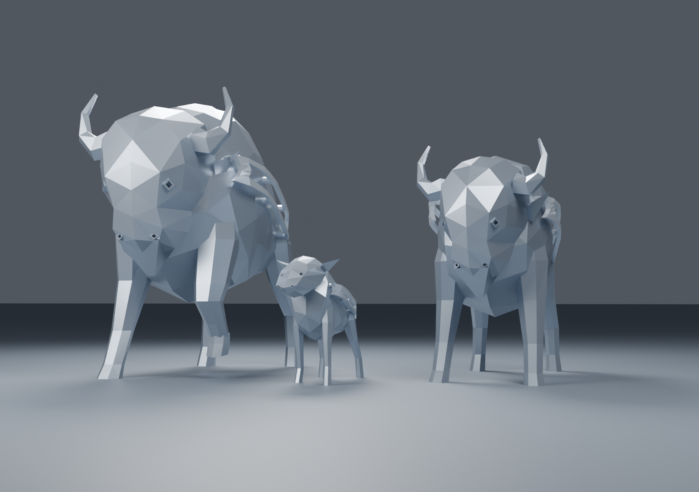
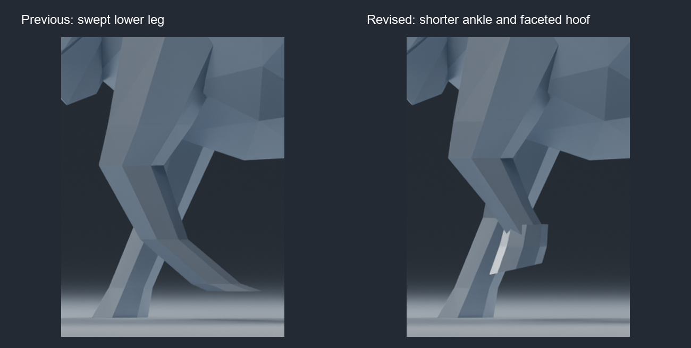

# Low Poly Football Bison Family

A faceted bull, cow and calf for 3D printing, inspired by the bison installation at the Buffalo Bills' Family Circle.

**[Download the complete V3 print pack](https://github.com/thehomelessguy/low-poly-football-bison-family/releases/download/v3.0.0/low-poly-football-bison-family-v3.zip)** · [Printing guide](START_HERE.md) · [Browse STL files](STL) · [Release](https://github.com/thehomelessguy/low-poly-football-bison-family/releases/tag/v3.0.0)

## Files

The pack contains **10 STL alternatives**, an editable Blender scene, generation scripts, previews and validation reports.

| Version | Location |
|---|---|
| Bull, cow and calf with charge stripes | [STL](STL) |
| Animals without stripe assemblies | [Plain versions](STL/optional_plain) |
| Individual animals on bases, plus the complete family on an oval base | [Display-base versions](STL/optional_with_bases) |
| Editable Blender scene | [Blender source](source/Bills_Bison_Family.blend) |

Unbased animal lengths are **200 mm**, **158.6 mm** and **89.7 mm**. The combined family base is **175 × 230 mm**. STL units are millimeters.

## Printing

**Supports are required. Use the integral-base bull for a freestanding display.** Its lifted-leg pose is not stable by itself.

All ten STLs passed mesh checks and were individually sliced in OrcaSlicer 2.4.0 with a 0.4 mm nozzle, PLA, 0.20 mm layers, three walls, 15% infill and automatic tree supports. Toolpaths were checked for bed fit and support beneath the raised hoof. The family display's supports and brim use essentially the full width of the 256 mm test bed.

**Not physically test printed.** Choose your actual printer and filament profiles, and follow the [printing guide](START_HERE.md). The included test profiles document verification settings; the download does not contain machine-ready G-code.

## V3 changes

- Corrected the bull's raised foreleg with a shorter ankle and distinct faceted hoof.
- Reinforced stripe frames, adult horn tips and the calf's tail stem.
- Widened the calf's stripe rails for the smaller family display.
- Added slicing and toolpath validation for all ten STL files.

## References and credit

These are photo-based interpretations, not scans or official sculpture files. The original sculpture, **Legacy (2026)**, is by **Blessing Hancock**, fabricated by **ART Research Enterprises**. See [reference and modeling notes](REFERENCE_NOTES.md) for the official galleries, dimensions and limitations. Reference photographs are not redistributed in this repository.
